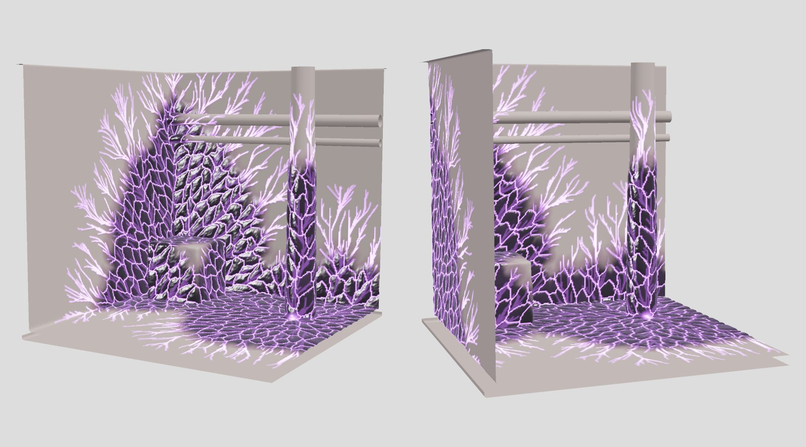

# Eclipse Biomass

A purpose-built generator for **Eclipse corruption**: procedural flesh-and-carapace
growth that spreads over characters and environments, in the spirit of Halo's
Flood. It grows glossy black carapace, sinew-like plates and violet glowing veins
over any host mesh, and exports the result to Unreal Engine 5.8.


The core is standard C++20 with no third-party dependency, so the same code
builds into the command-line tool, the tests and (next) the Unreal editor plugin.
Every growth is deterministic: the same host, seed and settings always produce
the same mesh, on any compiler.

## Build and test

You need a C++20 compiler (MSVC 2022, GCC 12+ or Clang 15+) and CMake 3.20 or newer.

```
cmake -S . -B build
cmake --build build --config Release
ctest --test-dir build -C Release
```

On Windows, open the folder in Visual Studio 2022 ("Open a local folder") and it
picks up the CMake project directly.

## Grow some corruption

```
# Built-in test human, 50% overtaken
eclipse-cli --host mannequin --coverage 0.5 --out out

# The same infection at four stages of growth (nested, so they animate)
eclipse-cli --host mannequin --stages 0.15,0.35,0.6,0.9 --out out

# An environment: a corridor corner, creeping upward
eclipse-cli --host corridor --cell 0.012 --coverage 0.55 --gravity 0.3 --out out

# Your own mesh (OBJ), starting where you choose
eclipse-cli --host my_room.obj --seed-at 1.2,0,-3.5 --seed-at 4,0,2 --coverage 0.4 --out out
```

Each run writes a `.glb` per stage and a PNG look-dev preview rendered by the
tool's own software renderer, so a growth can be judged without opening the
engine. `--help` lists every option.



## How it grows

| Stage | What it does | Technique |
|---|---|---|
| Spread | Decides where, and in what order, the corruption reaches | Weighted geodesic distance from the seeds over the mesh, with a noisy resistance field, a preference for creases and an optional climb or pool bias. The front stops at the requested share of the surface area. |
| Veins | Branching violet veins, thick at the source and thin scouts ahead of the front | Every vertex drains its area back toward the seed along the spread's shortest-path tree; where enough flow gathers, a vein forms (the same principle as river networks and leaf venation). Runs are smoothed into curves. |
| Carapace | Glossy black plates, stretched along the direction of growth into sinew strands, with grooves between them where some seams leak light | Anisotropic geodesic Voronoi cells from Poisson-scattered sites, with a crested height profile. |
| Surface | Swelling, knotted detail, and the displacement of the host | Fractal and ridged noise along the vertex normals. |

See [docs/visual-language.md](docs/visual-language.md) for how the reference
creatures map onto these generators, and [docs/roadmap.md](docs/roadmap.md) for
what comes next.

## Output contract

The `.glb` carries the corrupted mesh plus the data the Eclipse master material reads:

| Channel | Meaning |
|---|---|
| `COLOR_0.r` | infection, 0 = clean host tissue, 1 = fully overtaken |
| `COLOR_0.g` | glow: veins, leaking seams and the core around each seed |
| `COLOR_0.b` | crack: the seams between carapace plates |
| `COLOR_0.a` | plate tint, a random value per plate for colour variation |
| `TEXCOORD_0.x` | arrival: 0 at the seed, 1 at the current front, up to 4 beyond it. Animating a threshold over it replays the growth in the material. |
| `TEXCOORD_0.y` | height the surface was raised, in metres |

glTF uses +Y up and metres. Unreal's glTF importer converts to +Z up and centimetres.

## Layout

```
core/      the generator library (include/eclipse, src)
cli/       eclipse-cli
tests/     self-contained test runner (no framework)
docs/      design notes, references and previews
```
