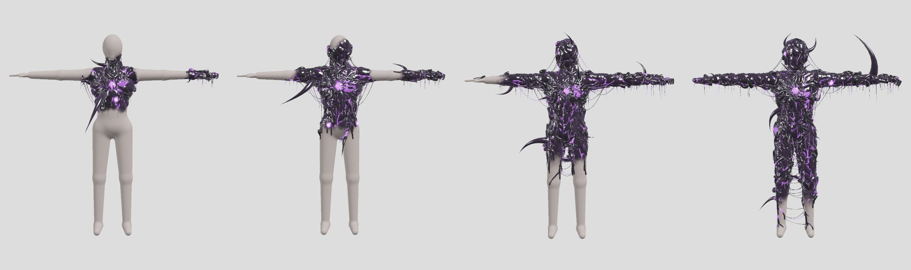
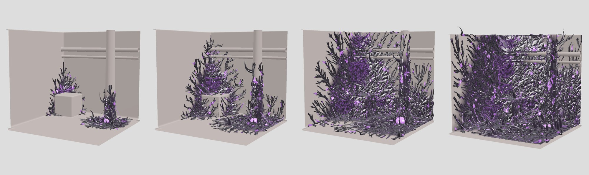

# Eclipse Biomass

A purpose-built generator for **Eclipse corruption**: procedural flesh-and-carapace
growth that spreads over characters and environments, in the spirit of Halo's
Flood. It grows glossy black carapace, sinew-like plates and violet glowing veins
over any host mesh, then sprouts thorns, glowing eyes and sacs, dripping strands,
bridging tendrils and torn membranes on top, and exports the result to Unreal
Engine 5.8.



This repository is an **Unreal Engine 5.8 plugin**: clone it into a project's
`Plugins` folder and grow corruption over static meshes and animated
characters in the level from **Tools → Eclipse Growth**, then let it spread,
recede and burn back during play. See [docs/unreal.md](docs/unreal.md).

The generator at its heart is standard C++20 with no third-party dependency, so
the same sources build into the plugin, a command-line tool and the tests.
Every growth is deterministic: the same host, seed and settings always produce
the same mesh, on any compiler.

## Build and test the generator

You need a C++20 compiler (MSVC 2022, GCC 12+ or Clang 15+) and CMake 3.20 or newer.

```
cmake -S . -B build
cmake --build build --config Release
ctest --test-dir build -C Release
```

On Windows, open the folder in Visual Studio 2022 ("Open a local folder") and it
picks up the CMake project directly.

## Grow some corruption

```
# Built-in test human, 85% overtaken
eclipse-cli --host mannequin --coverage 0.85 --out out

# The same infection at four stages of growth (nested, so they animate)
eclipse-cli --host mannequin --stages 0.15,0.35,0.6,0.9 --out out

# An environment: a corridor corner, creeping upward
eclipse-cli --host corridor --cell 0.012 --coverage 0.6 --gravity 0.3 --out out

# Your own mesh (OBJ), subdivided to 1 cm, starting where you choose,
# exporting only the corrupted shell to lay over the original
eclipse-cli --host my_room.obj --max-edge 0.01 --seed-at 1.2,0,-3.5 --seed-at 4,0,2 --overlay --out out
```

Each run writes a `.glb` per stage and a PNG look-dev preview rendered by the
tool's own software renderer, so a growth can be judged without opening the
engine. `--help` lists every option. `--no-growths` keeps only the corrupted
surface; `--feature-scale` sizes the growths (the corridor defaults to 2).



## How it grows

| Stage | What it does | Technique |
|---|---|---|
| Spread | Decides where, and in what order, the corruption reaches | Weighted geodesic distance from the seeds over the mesh, with a noisy resistance field, a preference for creases and an optional climb or pool bias. The front stops at the requested share of the surface area. |
| Veins | Branching violet veins, thick at the source and thin scouts ahead of the front | Every vertex drains its area back toward the seed along the spread's shortest-path tree; where enough flow gathers, a vein forms (the same principle as river networks and leaf venation). Runs are smoothed into curves. |
| Carapace | Glossy black plates, stretched along the direction of growth into sinew strands, with grooves between them where some seams leak light | Anisotropic geodesic Voronoi cells from Poisson-scattered sites, with a crested height profile. |
| Surface | Swelling, knotted detail, and the displacement of the host | Fractal and ridged noise along the vertex normals. |

Then the growths, as separate geometry on top of the surface. Older tissue (near
a seed) carries more and larger growths than the advancing front.

| Growth | Where | How |
|---|---|---|
| Vein tubes | Along every vein thick enough to see | Dark raised roots swept along the smoothed vein curves; a few stretches glow from within. |
| Roots | Over the whole corruption | Ropes walked over the surface along the spread's own paths in toward the cores, thickening as they go and turned off-line so they spiral around limbs and columns. |
| Hearts | At each seed | A glowing orb gripped by a ring of claws; at high coverage a second, wider ring opens it into a maw. Never larger than the curve of the body part it sits on. |
| Vertebrae | Along the thickest vein trunks | Segmented ridges, like a spine under the skin. |
| Horns | Oldest tissue, near the cores | Scythes swept along the growth: most modest, a rare few several times longer. |
| Eyes and sacs | Flatter hollows inside plates | Half-buried ellipsoids: eyes with a bright pupil ringed by a dark lid, or sacs glowing toward the crown. |
| Hanging strands | Undersides and overhangs | Gravity-drooping, swaying tubes ending in a drip; some glow. A strand stops where it would sink back into the host. |
| Bridges | Across gaps between surfaces that face each other | Sagging catenary tendrils, thinner in the middle; rejected if they would pass through the host. |
| Membranes | Some bridges | A sagging, two-sided sheet between two neighbouring bridges, torn through with noise-shaped holes whose rims glow. |

See [docs/visual-language.md](docs/visual-language.md) for how the reference
creatures map onto these generators, and [docs/roadmap.md](docs/roadmap.md) for
what comes next.

## Output contract

The `.glb` holds two meshes, `EclipseSurface` (the corrupted host) and
`EclipseGrowths` (everything added on top), so they can be imported, shaded or
toggled separately. Both carry the data the Eclipse master material reads:

| Channel | Meaning |
|---|---|
| `COLOR_0.r` | infection, 0 = clean host tissue, 1 = fully overtaken |
| `COLOR_0.g` | glow: veins, leaking seams and the core around each seed |
| `COLOR_0.b` | crack: the seams between carapace plates |
| `COLOR_0.a` | plate tint, a random value per plate for colour variation |
| `TEXCOORD_0.x` | arrival: 0 at the seed, 1 at the current front, up to 4 beyond it. Animating a threshold over it replays the growth in the material. |
| `TEXCOORD_0.y` | height the surface was raised, in metres (0 on growths) |

On growths, infection is always 1 and arrival is that of the tissue under them
plus a little, so in a growth animation they emerge just after their ground turns.

glTF uses +Y up and metres. Unreal's glTF importer converts to +Z up and centimetres.

## Layout

```
InfectionPlugin.uplugin   the plugin descriptor
Source/EclipseCore/       the generator (Public/eclipse, Private): plain C++, no engine headers
Source/InfectionRuntime/  the Eclipse Seed actor, Follower and Spread components, infection maps
Source/InfectionEditor/   the Eclipse Growth panel, mesh conversion, assets and materials
Resources/                plugin icon
cli/                      eclipse-cli
tests/                    self-contained test runner (no framework)
docs/                     design notes, references and previews
```
