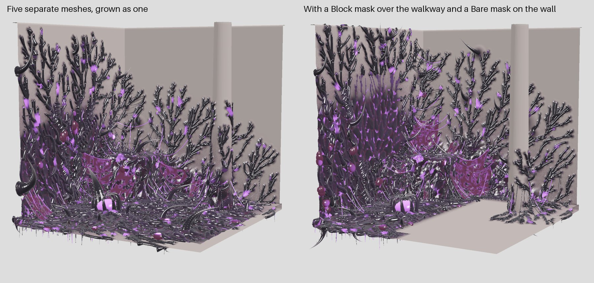
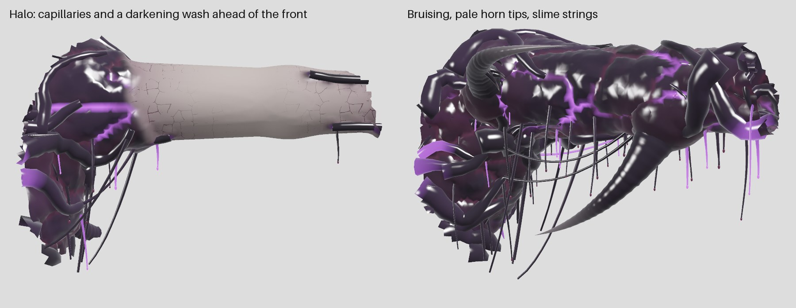

# Using the plugin in Unreal Engine 5.8

This repository *is* the plugin: `InfectionPlugin.uplugin` sits at its root and
Unreal only looks inside `Source/` and `Resources/`. The CMake project, the
CLI, the tests and the docs alongside them are ignored by the engine.

## Install

1. Your project needs to be a C++ project. If it is Blueprint-only, add any C++
   class once through **Tools → New C++ Class** to convert it.
2. Clone this repository into the project's `Plugins` folder:
   ```
   cd <YourProject>/Plugins
   git clone https://github.com/fallensignalstudios/InfectionPlugin.git
   ```
3. Right-click the `.uproject` file and choose **Generate Visual Studio project files**.
4. Build the editor target from Visual Studio (Development Editor, Win64), or just
   open the project and accept the prompt to rebuild the missing modules.
5. In the editor, check **Edit → Plugins → Procedural → Infection (Eclipse Biomass)** is enabled.

The plugin has three modules:

| Module | Type | What it holds |
|---|---|---|
| `EclipseCore` | Runtime | The generator itself: the same plain C++ sources the CLI and tests build. Its API header includes Unreal's platform definitions only during an Unreal build. |
| `InfectionRuntime` | Runtime | The **Eclipse Seed** actor (editor-only, stripped from cooked builds). |
| `InfectionEditor` | Editor | The **Eclipse Growth** panel, mesh conversion, asset writing and the materials. |

## Grow corruption

1. Open **Tools → Eclipse Growth**.
2. Select a static mesh actor in the level and press **Add Seed**, or drag an
   **Eclipse Seed** in from the Place Actors panel. Move the seed to where the
   infection should start. Several seeds grow several outbreaks that merge.
   A seed affects a mesh when it is within 1 m of the mesh's bounds.
3. Select the mesh (or several) and press **Grow on Selected**.

The generated actors are attached to the host, labelled `<Host> Eclipse_Shell`,
`<Host> Eclipse_Growths` and `<Host> Eclipse_Flesh` (the soft tissue), and
replaced each time you grow again. Their
meshes are written to `<Output Folder>/Generated` and are unsaved until you
**Save All**. Undo removes the placed actors; the generated assets stay until you delete them.

**Remove from Selected** takes the corruption off each selected host (or the
host of selected corruption): its generated actors, its Spread and Follower
components, and, after a Replace grow, shows the host mesh again. It can be
undone, and leaves the generated assets in the output folder. Hosts hidden by a
Replace grow from before this button existed are not marked; show them by
hand (Rendering → Visible).

### If an earlier version was used

The panel remembers its settings, so values from before the art pass (plate
thickness, stretch, seam glow) stay as they were. Right-click the panel's
categories and **Reset to Default** to pick up the new look, and press
**Rebuild Materials** once: it regenerates the carapace material with the
detail maps and the tissue in its seams. (The soft-tissue material and the
detail textures are created on the next grow even without it.)

### Output modes

- **Overlay** (default): only the corrupted part of the surface is generated,
  as a shell 1.5 mm above the host. The host keeps its own materials wherever
  the corruption has not reached. Use this for real assets.
- **Replace**: the whole host is regenerated and the original is hidden; clean
  areas use the material's *Host Color*. Handy for untextured blockouts.

### Resolution

Corruption detail lives on vertices, so the host is subdivided until no edge is
longer than **Resolution** (default 1 cm) before growing. Large environment
meshes at 1 cm can reach millions of vertices; raise Resolution to 2–4 cm for
architecture, and **Feature Scale** to about 2. Growing stops with a message
rather than exceed **Max Vertices**.

Vertices that are split along UV or smoothing seams are welded first, so the
spread crosses those seams. Generated meshes have Nanite enabled by default.

### Rooms and masks

Select every mesh of a room (floor tiles, walls, props) and press **Grow on
Selected**: with **Grow as One** on (Mesh, the default) the static meshes grow
as one surface, the corruption crossing from piece to piece wherever they come
within **Contact Gap** (2 cm), from the seeds near any of them. Each piece gets
its own shell, infection map and Eclipse Spread component; the growths and soft
tissue of the whole room are attached to the first piece selected. Turn Grow as
One off to grow each mesh on its own. Characters always grow on their own.

Place **Eclipse Mask** actors (Place Actors panel) to shape where it goes.
Scale the box over the area, or switch its Shape to Sphere:

| Mode | Colour | Effect |
|---|---|---|
| Block | red | The corruption never enters, and routes around: walkways, doors, gameplay space. |
| Bare | yellow | The surface may corrupt but nothing grows on it: no horns where players walk. |
| Dense | violet | The corruption is drawn here first, so it is oldest and most overgrown. |

**Falloff** softens the edge; **Strength** below 1 makes a Block only slow and
thin the corruption, and a Dense pull less hard. Every enabled mask in the
level applies to every grow, on characters too. Masks are editor-only.

**Previous Variation** and **Next Variation** step the Seed and grow the
selection again: the same settings, a different growth.



**Preset** (at the top of the panel) picks a starting look: Eclipse, Creep,
Thornfield, Rootmass, Hive, Carcass or Cathedral (see the README). Choosing one
rewrites the settings below it to match, ready to tweak; seed, coverage,
gravity, plate size and feature scale are kept. Values the panel does not show,
such as spacings and cluster sizes, also come from the preset. From Python or
Blueprint, set `Preset` on the settings and call `ApplyPreset`.

**Formations** adds large set pieces: **Spires** (twisted columns on floors),
**Ribcages** (arching bone on floors), **Pods** (glowing egg cocoons) and
**Shelves** (bracket fungus on walls), each with its size. Use them on
environment meshes at Feature Scale 2 or more.

**Bruising** and **Halo Reach** (Colour) set how mottled the carapace is and
how far ahead of the front clean tissue darkens and grows capillaries; 0 turns
the halo off. **Slime** and **Slime Chance** control the mucus strings.

**Fusion** (Growths) sets how much the tissue swells up around each growth's
base; 0 leaves growths sitting on the surface. **Roughness** sets how knotted,
ringed and lumpy growths are; 0 makes them smooth and round and about halves
their triangles, worth it on skinned characters without Nanite. **Root
Branching** and **Horn Barbs** control the side rootlets and the hooked thorns
on big horns. **Sacs** and **Sac Chance**
control the pod clusters that gather in folds and corners.

## Characters (skeletal meshes)

Select an actor with a skeletal mesh and grow as usual. The corruption is
grown over the mesh's **reference pose**, so keep the character in its
reference pose while placing seeds (no animation assigned in the editor), and
seeds go where the corruption should start on that pose.

The result is two skeletal meshes on the host's own skeleton,
`SK_Eclipse_<Host>_Shell`, `SK_Eclipse_<Host>_Growths` and `SK_Eclipse_<Host>_Flesh`, each a copy of the
host mesh reduced to one LOD and one material. Every vertex carries bone
weights: the shell takes the weights of the skin it lies on, and growths blend
the weights of the tissue nearest them, so a strand follows the limb it hangs
from and a membrane between arm and torso stretches with both.

In the level they are added to the host actor as **Eclipse Follower**
components, attached under its skeletal mesh. A follower copies its parent's
pose every frame, so the corruption plays whatever animation the character
plays. To use it on a character Blueprint, add an *Eclipse Follower* component
under the character's Mesh and set its Skeletal Mesh Asset to the generated mesh.

Limits for now:
- Hosts with clothing assets are refused; grow on a copy without clothing.
- Growths are rigid with the bone that carries them: strands do not swing or
  hang with gravity as the character moves. Physics on strands is a later step.
- The host's morph targets are not carried over to the corruption.
- Growing places followers on level actors. On a character Blueprint whose
  skeletal mesh is added in the Blueprint itself (not the inherited Mesh),
  the construction script may rebuild that component and orphan the
  followers; add the follower in the Blueprint instead, as above.


## Spreading, receding and burning during play

Every grow also adds an **Eclipse Spread** component to the host actor and
writes `IM_Eclipse_<Host>`, a sparse record of where the corruption is and when
each part of it arrived. At runtime the component drives every Eclipse material
on the host and on the actors attached to it.


| On the component | |
|---|---|
| `Growth` | How far the spread has played: 0 nothing, 1 the corruption as grown, `FullGrowth` (set from Vein Reach when grown, about 1.5) everything including the veins that ran ahead. |
| `bSpreadOnBeginPlay`, `SpreadDuration` | Start from nothing when play begins and take this many seconds to finish. |
| `StartSpread`, `Recede`, `SetPlayRate`, `SetGrowth` | Drive it from Blueprint: play forward, play backward, any speed, or jump. |
| `OnSpreadFinished`, `OnFullyReceded` | Events at either end. |
| `Burn(Location, Radius)`, `ClearBurns` | Cut the corruption away in a sphere; the edge smoulders with ember light (`EmberColor`, `BurnSoftness`). Scars are permanent: up to 64 are kept apart, and past that a new burn grows the nearest scar to enclose both, so burned tissue never comes back. |
| `StartOutbreak(Location, MaxRadius, Speed)`, `ClearOutbreaks` | Reveal the grown corruption outward from a point, whatever `Growth` says: a sphere growing at `Speed` cm/s up to `MaxRadius` (speed 0 for all at once), its front glowing as it goes. Tissue that arrived late in the grown spread lags behind the front by up to 1.5 × `OutbreakRoughness`, so the front creeps along the corruption's own fingers rather than as a clean sphere; `OutbreakSoftness` is its width. Up to 64 at a time. |
| `OnBurned`, `OnOutbreakStarted`, `OnOutbreakFinished` | Events with a world location and radius: hang sounds, Niagara bursts and camera shakes on them. `OnBurned` reports the scar as kept (after any merge). |
| `GetInfectionAt(Location, Radius)`, `IsInfectedAt` | How infected a spot is right now (0..1): arrived or revealed by an outbreak, and not burned. Use it for damage zones, AI avoidance, audio. |
| `GetBurnCount`, `GetOutbreakCount`, `GetWorldBounds` | What it holds, and the world box around its corruption. |
| `GetState`, `RestoreState` | Everything above, for save games (see Saving). |

### Without knowing which actor: the Eclipse Infection subsystem

Gameplay usually knows a world point, not which infected actor is there. The
**Eclipse Infection** world subsystem (`Get World Subsystem` in Blueprint) knows
every spread in the level:

| | |
|---|---|
| `GetInfectionAt(Location, Radius)`, `IsInfectedAt` | The strongest infection there, across every infected actor. |
| `BurnAt(Location, Radius)` | Burn every spread the sphere reaches: a flamethrower or grenade calls this where it hits. Returns how many. |
| `StartOutbreakAt(Location, MaxRadius, Speed)` | Start an outbreak on every spread within `MaxRadius`: a spore pod bursting, a projectile landing. |
| `GetSpreadsNear(Location, Radius)` | The spread components themselves, to drive them directly. |

### Senses for pawns and AI: the Eclipse Infection Sensor

Add an **Eclipse Infection Sensor** component to a pawn (at its feet, or on a
weapon muzzle, or anywhere). Every `Interval` seconds (0.2) it asks the
subsystem about `SearchRadius` around itself and fires:

- `OnEnterInfection(Infection)` when it reaches `Threshold` (0.5),
- `OnLeaveInfection` when it drops below (walked off, burned, receded),
- `OnInfectionTick(Infection, DeltaSeconds)` on every check while on it:
  apply damage as `Rate × Infection × DeltaSeconds`, slow the pawn, or drive
  a heartbeat sound.

`Sense()` checks at once; `GetInfection` and `IsInInfection` give the last
result. For AI, call the subsystem's `IsInfectedAt` from an EQS or a
Behaviour Tree service to keep a pawn off the corruption, or onto it.

### Multiplayer

The Spread component replicates when its actor does: tick **Replicates** on a
host that should stay in step across players (static level geometry usually
does not replicate by default). Call `Burn`, `StartOutbreak`, `StartSpread`,
`Recede` and `SetGrowth` (or the subsystem's `BurnAt` and `StartOutbreakAt`)
on the server; every client follows, and a client that joins later sees the
same scars and outbreaks, each outbreak's front placed by how long ago it
started on the server's clock. A client calling them on its own changes only
what it sees, until the server's state next arrives. Queries and the sensor
answer on any machine from what that machine shows.

### Saving

`GetState` returns an `Eclipse Spread State` (growth, play rate, burns and
outbreaks with their fronts) to keep in a `SaveGame`; `RestoreState` puts it
back after loading, carrying on from where it was. Keep one per infected
actor, keyed by the actor's name.

Notes:
- Burns, outbreaks and queries need the materials from this version: press
  **Rebuild Materials** once if you grew with an earlier one. Burns and
  outbreaks reach the materials as a small event texture (`Events`, positions
  relative to `EventOrigin`, so they stay exact far from the world origin).
- Saved growth settings retain their old values. To use the revised darker
  palette, reset the colour, vein and seam settings to their defaults before
  growing again.
- Regrow scaled hosts made with earlier live-spread builds to rewrite their
  infection maps with actor-space sample spacing. Query radii stay in world
  centimetres, and burns are checked at the nearby samples rather than the
  query centre.
- The component changes the materials only in play (PIE, Simulate or a
  build). In the editor, preview a stage by setting `Growth` on the
  `MI_Eclipse_*` instances.
- Animate spreads in **Overlay** mode. In Replace mode the plates' raised
  shape stays visible, in the host colour, ahead of the spread.
- `GetInfectionAt` on a character answers for its reference pose, not its
  current animation.
- An infected actor attached under another plays its own spread; the parent's
  component leaves it alone.

## The materials


The first grow creates, under `<Output Folder>/Materials`, two masters, four
instances and two detail textures. Edit the instances; regenerate everything
with **Rebuild Materials**.

| Asset | What it is |
|---|---|
| `M_EclipseBiomass` | Carapace: masked, two-sided, clear coat |
| `M_EclipseFlesh` | Soft tissue: masked, two-sided, subsurface scattering |
| `MI_Eclipse_Overlay` | overlay shells |
| `MI_Eclipse_Replace` | replacing surfaces |
| `MI_Eclipse_Growths` | horns, claws, roots, vertebrae, strands, bridges |
| `MI_Eclipse_Flesh` | hearts, throats, eyes, sacs, membranes, drips |
| `T_EclipseChitin`, `T_EclipseFlesh` | Generated detail maps (512², uncompressed): height slopes in RG, height in B, cavity in A. Not colour. |
| `T_EclipseCapillaries` | Generated vessel network for the halo (B: 1 along each vessel). |



The overlay material's opacity is dithered (Dither Temporal AA), so the halo's
partial wash reads as a soft tint over the host under TSR or TAA.

The detail is tiled triplanar over the mesh's **bind pose** (pre-skinned
position), so it stays fixed to a character's skin as it animates. The
materials output a world-space normal, so they need no tangents from the mesh.
Their logic is small Custom (HLSL) nodes you can read and edit in the material
editor. Parameters:

| Parameter | Default | Effect |
|---|---|---|
| `Growth` | 4 | How far the growth has played. Arrival is 0 at the seed and 1 at the front, so **animate Growth from 0 to about 1.4 to watch the infection spread** (Sequencer, a Timeline, or a Material Parameter Collection). |
| `Softness` | 0.08 | Width of the advancing edge while animating. |
| `GlowIntensity` | 12 | Emissive strength of veins, seams and eyes. |
| `PulseSpeed`, `PulseAmount` | 0.6, 0.35 | Waves of light travelling outward from the seed. |
| `CarapaceColor`, `CarapaceTint` | near-black, violet | The shell; the tint varies per plate. |
| `GlowColor` | violet | |
| `EmberColor`, `BurnSoftness` | orange, 40 cm | The smouldering edge of a burn, and its width. |
| `Events`, `EventOrigin`, `BurnCount`, `OutbreakCount` | empty | Set by the Eclipse Spread component: its burns and outbreaks. |
| `OutbreakSoftness`, `OutbreakRoughness` | 30, 60 cm | Width of an outbreak's front, and how far late-arriving tissue lags behind it (also on the component). |
| `InflamedColor` | dark magenta | Tissue at the front, before it blackens. |
| `HostColor` | grey | Clean tissue, Replace mode only. |
| `ClearCoatRoughness` | 0.06 | The wet sheen. |
| `DetailScale` | 12 cm | Size of one tile of the chitin detail (flesh tiles 1.7 times finer). |
| `DetailStrength`, `FleshDetail` | 0.35, 1.3 | How deep the detail reads; the second multiplies it on soft tissue. |
| `CavityStrength` | 0.6 | Darkening down in the detail's grooves. |
| `FleshColor`, `FleshDeep` | dark wine | Soft tissue, and its folds. Also shows in carapace seams. |
| `ScatterColor`, `Translucency` | red-violet, 0.65 | Light passing through soft tissue (flesh master). |
| `FleshRoughness`, `FleshGlow` | 0.32, 0.15 | Wet sheen of tissue; faint scattered light at grazing angles. |
| `BruiseColor`, `BoneColor` | dark wine, pale grey-violet | Bruised patches; horn, claw and tooth tips. |
| `HaloReach` | 0.35 | Kept equal to the panel's Halo Reach on every grow, so the halo ends where the shell does. |
| `HaloStrength`, `HaloColor` | 0.6, dusky | The darkening wash ahead of the front. |
| `CapillaryScale`, `VesselColor` | 10 cm, dark wine | Size of the capillary pattern, and its colour. |
| `OverlayMode`, `IsGrowth` | set per instance | Leave as the instances set them. |

### Nanite displacement

Turn on **Nanite Displacement** (Output) and press **Rebuild Materials** to
push the carapace detail out into real geometry, up to **Displacement Depth**.
It needs Nanite on the generated meshes (the default for static hosts) and, in
the project's `Config/DefaultEngine.ini` under `[/Script/Engine.RendererSettings]`:

```
r.Nanite.AllowTessellation=1
r.Nanite.Tessellation=1
```

then an editor restart. Without them the setting does nothing. Characters
(skeletal outputs) keep normal-map detail only.

The vertex data the material reads is listed in the README's output contract.

## If it does not compile

The generator core is built and tested on Windows, Linux, GCC, Clang and MSVC
by CI, including as a DLL that exports only the functions marked
`ECLIPSECORE_API`, the way the Unreal editor links it. On UE 5.8.3, the plugin's
Editor, Game Development and Game Shipping builds have passed with precompiled
headers and unity builds disabled (`-NoPCH -NoSharedPCH -DisableUnity`, the
flags used by `BuildPlugin -StrictIncludes`), with the 35 standalone tests and
six Unreal automation tests passing, as of the live-spread fixes. The realism
pass adds standalone tests (54 now) and a materials automation test; its
engine side awaits the same build. Run all Unreal tests with
`Automation RunTests Infection`: they check skeletal corruption-channel bytes,
skeletal regeneration after host changes, sparse-map queries, and live-spread
burns and scaled world distances. The three spread tests failed on the original
live-spread implementation and pass after the query fixes. These synthetic
fixtures do not qualify the appearance or animation of a production character.

Engine APIs that have moved between versions, and what to check:

| Symptom | Where | Fix |
|---|---|---|
| Syntax errors at `ECLIPSECORE_API` declarations in a no-PCH build | `eclipse/api.h` | UBT's export macros require `HAL/Platform.h`; include it only when building an Unreal module so standalone builds stay portable. |
| `GetMeshDescription` / `CreateMeshDescription` / `CommitMeshDescription` errors | `EclipseMeshBridge.cpp` | These are the standard UStaticMesh editor calls; check their current signatures in `Engine/StaticMesh.h`. |
| `FCustomInput::InputName` type mismatch | `EclipseMaterials.cpp` | It is an `FName` in UE5; if it became an `FString`, drop the `FName(...)` wrap. |
| `UMaterialEditingLibrary` missing | `InfectionEditor.Build.cs` | It lives in the `MaterialEditor` module, already listed. |
| Material settings not applied | `EclipseMaterials.cpp` | Blend mode and two-sided are set by property name; check the names `BlendMode` and `TwoSided` on `UMaterial`. |
| Nanite not enabled on outputs | `EclipseMeshBridge.cpp` | Set by property name `NaniteSettings.bEnabled`; enable it in the mesh editor meanwhile. |
| `PreSkinnedPosition` / `VertexInterpolator` / `Transform` errors | `EclipseMaterials.cpp` | Detail uses the bind-pose position through a vertex interpolator; check those expression classes' member names (`VSOutput`, `Input`, `TransformSourceType`). |
| Detail textures empty or wrong | `EclipseMaterials.cpp`, `BuildDetailTexture` | Written with `Source.Init(..., TSF_BGRA8, ...)` and `TC_VectorDisplacementmap`; check `FTextureSource::Init`. |
| Displacement setting does nothing | `EclipseMaterials.cpp` | Tessellation and its depth are set by property name (`bEnableTessellation`, `DisplacementScaling`); a warning in the log says if they were not found. Enable them in the material's Nanite settings. Check the two CVars above. |
| Lighting looks inverted or flat | `EclipseMaterials.cpp` | The normal is world space via the `bTangentSpaceNormal` property set by name; check it is off on both masters. |
| Skeletal output is empty or fails to commit | `EclipseMeshBridge.cpp`, `WriteSkeletalMesh` | The description includes skin weights and the host's reference bones; check the current skeletal mesh commit and build APIs. |

Paste the compiler output into a session and it can be fixed quickly.
