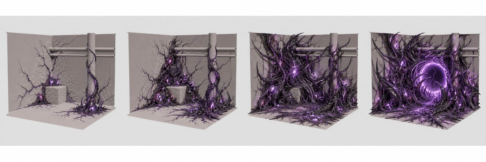

# Eclipse visual language

What the reference creatures share, and which generator is responsible for each trait.

| Reference | |
|---|---|
|  | **Infected host.** A human body partly overtaken: sinew wrapped along the limbs, violet light in the grooves, the head becoming a carapace crest. This is the primary use case: the tool corrupts an existing body. |
|  | **Late stage.** The same process near 100%: the silhouette frays into hanging strands, membranes between arm and body are torn through with holes. |
|  | **Spider form.** Spined carapace, dripping strands under the body, glowing seams down the limbs. |
|  | **Carrier.** A swollen body with embedded glowing nodules and a mouth cavity. |
|  | **Ray.** Perforated membranes, a bright vein core down the centre line, hanging tendrils. |

## Shared traits

| Trait | Generator | Status |
|---|---|---|
| Glossy black carapace, plates over the body | Carapace plates, crested profile | Done |
| Sinew bundles running along limbs | Plates stretched along the spread direction | Done |
| Violet light in cracks and seams, but not every seam | Seam leak mask | Done |
| Branching glowing veins, brightest at a core | Flow-accumulation veins, seed core glow | Done |
| Veins running ahead into clean tissue | Vein reach past the front | Done |
| Spikes and thorns on ridges, shoulders and crests | Thorns on the most convex plate crests, leaning along the growth | Done |
| Glowing nodules and eyes in hollows | Eyes and sacs in flatter plate hollows, emissive pupils | Done |
| Strands hanging under gravity, drips | Hanging strands with drips, and catenary bridges | Done |
| Torn membranes with holes | Two-sided membranes between bridges, noise-torn, glowing rims | Done |
| Fraying silhouette at late stage | Denser, longer strands on old tissue; tearing the host outline itself | Partly |
| Wet sheen, pulse, subsurface light | Unreal master material | Phase 3 |

## Palette

- Carapace: near-black with a violet cast, linear about (0.02, 0.015, 0.025), clear-coat gloss.
- Glow: saturated violet, linear about (0.55, 0.15, 1.0), white-hot at the core.
- Host tissue at the front: inflamed, desaturated magenta before it blackens.

## Art direction: the designer's corridor

What the target asks for, and how the generator answers it:

| Target | Generator |
|---|---|
| Dark, raised, root-like veins; violet only in cracks and cores | Vein tubes are thick and black with rare lit fissures; painted veins stain the tissue dark instead of glowing |
| Dense ropy tangle climbing everything, wrapping the column | Roots: ropes traced over the surface toward the cores, with a twist |
| A few huge scythe horns among smaller ones | Horns with a long-tailed size, gathered on the oldest tissue |
| Glowing cores with tendrils radiating from them | Hearts at the seeds; roots converge on them |
| Spine-like ridges on the floor | Vertebrae along the trunks |
| Mostly black, glow as accent | Seams barely leak light, membranes and strands are unlit, the inflamed front is a dark bruise |
| A maw in the final frame | The heart's second ring of claws at high coverage |

Not there yet: the final frame's portal is a tunnel carved into the wall; ours
is a claw ring over a sunken orb, since the generator adds geometry but does
not cut into the host. The column wrapping is looser than the target's.
